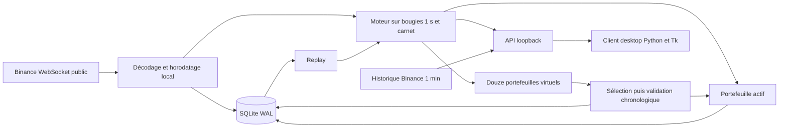

# Architecture de VisualTrader

## Ingestion et horloges

`market.mjs` ouvre le [flux public Binance Spot](https://developers.binance.com/docs/binance-spot-api-docs/web-socket-streams) en multiplexant `btcusdt@kline_1s`, `btcusdt@trade` et `btcusdt@depth20@100ms`. Le moteur conserve la réception locale en millisecondes, les identifiants et les timestamps Binance disponibles. Le carnet partiel contient les 20 meilleurs niveaux. L’historique REST 1 min est utilisé seulement par la vue Time.

`engine.mjs` traite les messages dans l’ordre de réception. Une clôture doit être nouvelle. Les transactions et les livres déjà vus sont ignorés par le moteur, tandis que les messages restent dans l’archive. Les lacunes remettent en chauffe les indicateurs. Un flux obsolète bloque l’exécution et annule les intentions devenues invalides. La reconnexion utilise un délai exponentiel plafonné à 30 s. Le délai maximum sans message pour relancer la connexion est de 10 s.

## Portefeuille et coût d’exécution

Le portefeuille commence à 10 000 USDT. Les entrées long spot engagent jusqu’à 1 000 USDT. Un signal fixe le milieu du carnet au moment de sa création. L’exécution utilise un nouveau snapshot valide après le délai simulé. Les achats balayent les asks et les ventes balayent les bids. Un ordre est rejeté s’il dépasse le budget, la profondeur disponible ou le délai d’expiration de 3 s. Un spread supérieur à 5 pb bloque les entrées. Le solde acheteur est débité du notionnel et des frais. Le solde vendeur est crédité du notionnel diminué des frais.

- **P&L brut réalisé** = (prix de vente − prix d’achat) × quantité. Les prix sont les prix simulés, slippage inclus.
- **P&L net réalisé** = P&L brut − frais des deux côtés.
- **Capital liquidable** = cash + produit estimé de la liquidation de la position, net du slippage et des frais de sortie. Il est indisponible si les bids frais ne couvrent pas la quantité.
- **Écart au signal** = différence directionnelle entre le prix exécuté et le milieu du carnet au signal, multipliée par la quantité. Il inclut le spread, le mouvement pendant l’attente et le slippage. Il peut être favorable et ne doit pas être retranché une deuxième fois.
- **Drawdown max** = plus grande baisse en USDT depuis un sommet du capital liquidable.
- **Profit factor** = somme des gains nets divisée par la somme absolue des pertes nettes. Il est affiché infini si des gains existent sans perte.

## Stratégies et décisions

Les douze variantes combinent les moyennes rapides 7/15/25 s, les moyennes lentes 45/99 s et des seuils de 3/8 pb. Un achat exige une tendance positive au-delà du seuil, un prix au-dessus de la moyenne rapide et un flux acheteur d’au moins 10 % du volume observé sur cinq secondes. Une position sort à l’inversion des moyennes, sur un mouvement au bid de −32 pb ou +65 pb, ou après 300 s. Le délai après une sortie est de 15 s.

Chaque fenêtre de 15 min compare douze portefeuilles partant à égalité. Le score déduit la moitié du drawdown max du rendement net liquidable et exprime le résultat en pb du capital initial. Le meilleur candidat éligible est nommé pour la fenêtre suivante. Cette fenêtre valide uniquement le candidat nommé précédemment, contre zéro (cash) et le score de la variante active sur les mêmes données. Les critères sont cinq cycles terminés, 98 % de couverture et un avantage d’au moins 1 pb. Une variante active qui termine sous zéro avec assez d’observations peut revenir au cash. Les changements attendent que le portefeuille actif soit à plat. L’audit garde le classement, la couverture et le motif à chaque fenêtre.

Cette réflexion est algorithmique. Le moteur compare des variantes prédéfinies et ne réécrit ni son code ni ses règles de risque. Le test chronologique écarte l’utilisation de la fenêtre de validation pour nommer ce même candidat. Il ne mesure pas la robustesse sur des régimes indépendants à long terme.

## Journal et reproductibilité

`app.mjs` tient une session de capture par démarrage. `market` contient chaque message brut et sa réception. `audit` contient les connexions, signaux, refus, exécutions, commandes et décisions. `state` stocke le portefeuille actif, la stratégie et l’état de pause. SQLite utilise WAL et transactions synchrones par lots autour de 250 ms. Un verrou SQLite par base exclut les seconds écrivains live. Le dernier lot non validé peut être perdu lors d’un arrêt forcé.

Le replay lit une capture par numéro de session et remesure la stratégie depuis un portefeuille vierge avec la configuration fournie au lancement. Il reproduit l’ordre et les horaires des messages, y compris lors d’une lecture accélérée. Il n’applique pas les anciens états du portefeuille ni les commandes manuelles. Les périodes sans messages restent des lacunes. La démo utilise un marché synthétique déterministe pour vérifier les transitions. Les fills et gains synthétiques servent aux tests et ne constituent pas des résultats de marché.

## Client de bureau

`desktop.py` effectue les appels loopback dans un seul thread de travail. La boucle Tk récupère le résultat et ne modifie que l’onglet visible. Les séries courtes et décisions récentes transitent dans un JSON réduit. Le graphique Time récupère l’historique à la demande et réduit les barres de volume selon la largeur du Canvas. Le client fonctionne sans navigateur, sans WebView et sans paquet Python tiers. Le processus de marché reste indépendant du rendu.

## Périmètre et limites

Application locale de paper trading. Aucun order routing, modèle maker, ordre partiel, priorité de file, impact de marché ou filtre de placement propre au compte Binance. Chaque candidat contrefactuel lit le même carnet et ne retire pas de liquidité aux autres. Les snapshots à 100 ms ne retracent pas les modifications intermédiaires. Les commissions sont modélisées en USDT et ne reproduisent pas exactement des commissions prélevées en BTC ou BNB. L’alimentation provient des flux publics du marché affiché sur Chrome. Aucune capture de pixels ni dépendance à l’onglet, à la session Binance ou au compte de trading.

Le runtime vise un usage local supervisé. Il n’inclut pas de disponibilité multi-hôte, de supervision externe ou de rétention automatique. SQLite embarqué reste marqué expérimental par Node 24.
